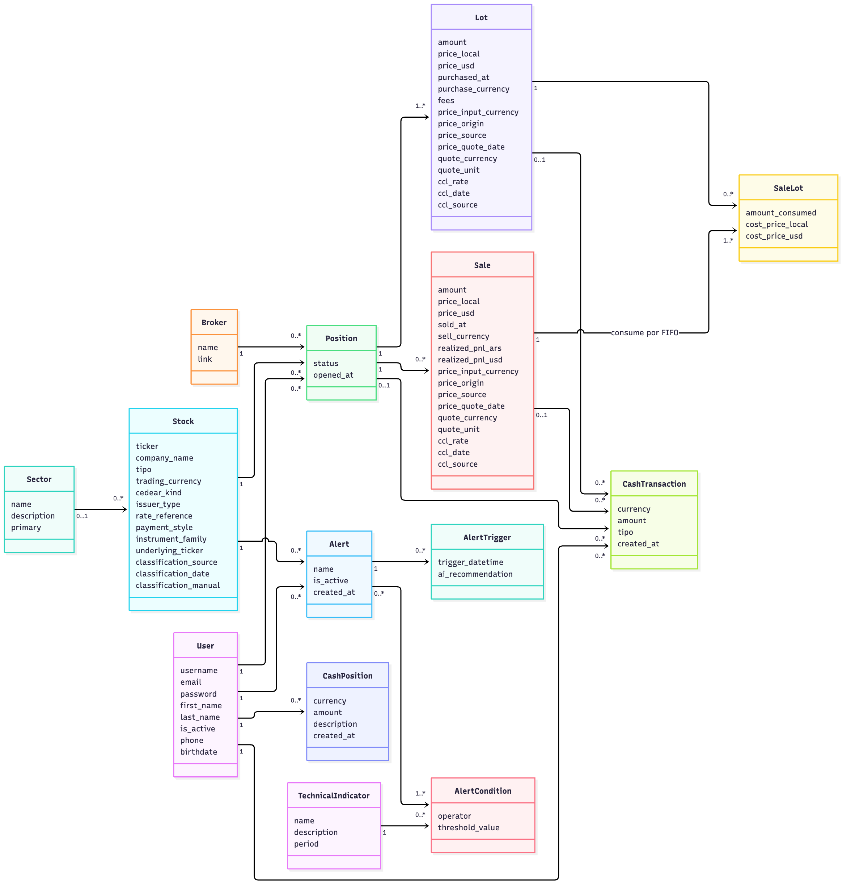
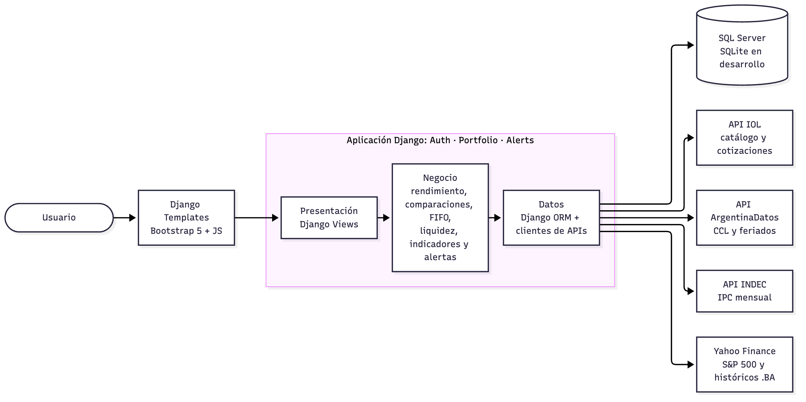

# PortfolioAR
## Descripción del proyecto
PortfolioAR es una aplicación web orientada a inversores argentinos que operan en mercados de acciones y bonos locales e internacionales a través de CEDEARs. La plataforma permite gestionar la cartera de inversiones de forma centralizada, obteniendo métricas reales de rendimiento, análisis técnico automatizado y alertas configurables basadas en indicadores financieros.

El diferencial clave del sistema es contextualizar el rendimiento de cada inversión no solo en términos absolutos, sino comparándolo contra el índice S&P 500 y contra la inflación argentina oficial del mismo periodo, respondiendo la pregunta central del inversor retail argentino: **¿le gané a la inflación?**

El sistema resuelve los siguientes problemas concretos:

- El acceso a herramientas de análisis financiero profesional en Argentina requiere mucho conocimiento sobre el mercado.
- El inversor retail no tiene una forma simple de saber si su cartera realmente le ganó a la inflación o al mercado.
- No existe una herramienta que combine seguimiento de portfolio y alertas técnicas en un solo lugar, en español y orientada a Argentina.

## Modelo de Dominio



## Bosquejo de Arquitectura

El sistema sigue una arquitectura de 3 capas:



División horizontal de responsabilidades:
- La **capa de presentación** expone vistas Django y renderiza los templates. No accede directamente a la base de datos.
- La **capa de negocio** concentra todos los cálculos de rendimiento, indicadores técnicos y evaluación de alertas. No contiene elementos de interfaz.
- La **capa de datos** gestiona todas las consultas a SQL Server mediante el Django ORM (con `mssql-django`) y las llamadas a APIs externas (IOL, INDEC).

División vertical por casos de uso:
- Auth: Gestión de usuarios (registro, login, logout y cambios de contraseña).
- Portfolio: Registro de posiciones, ordenes de venta (costeo FIFO) y gestión de liquidez en ARS/USD (depósitos y retiros).
- Alerts : Configuración y evaluación de alertas técnicas.

## Requerimientos

### Funcionales

**Módulo 1 – Gestión de Portfolio**

- RF01: El usuario puede registrarse, iniciar sesión y cerrar sesión.
- RF02: El usuario puede registrar operaciones de compra y venta de acciones, bonos, letras y CEDEARs (instrumento, cantidad, precio, fecha, broker). El precio y el CCL de la fecha se obtienen automáticamente y quedan guardados como snapshot de la operación; la compra debe hacerse en la moneda de cotización del instrumento y descuenta la liquidez disponible.
- RF03: El sistema calcula el rendimiento de cada posición: precio de compra vs. precio actual, ganancia/pérdida en % y en dólares y rendimiento anualizado (este último solo cuando la tenencia supera los 30 días).
- RF04: El sistema compara el rendimiento de cada posición contra el S&P 500 (índice `^GSPC`) para el mismo período. Si el período es demasiado corto para la granularidad del índice, se usa una ventana de 12 meses y la pantalla lo indica.
- RF05: El sistema compara el rendimiento del portfolio contra la inflación acumulada del INDEC para el período de inversión (con la misma ventana de 12 meses cuando el período no alcanza un mes completo).
- RF06: El sistema calcula y muestra indicadores técnicos actuales por posición.

**Módulo 2 – Alertas**

- RF07: El sistema evalúa periódicamente las condiciones de alerta y registra los disparos en el historial.

### No Funcionales

#### Portability

**Obligatorios**

- El sistema funciona correctamente en múltiples navegadores (Chrome, Firefox, Edge).

#### Security

**Obligatorios**

- Todas las contraseñas se almacenan mediante un hash criptográfico seguro. La implementación utiliza PBKDF2, provisto por el sistema de autenticación de Django.
- Todas las API Keys y tokens (IOL) no se exponen de manera pública (uso de variables de entorno / `.env`).

#### Maintainability

**Obligatorios**

- El posee diseñarse con la arquitectura en 3 capas. (Ver [checklist_capas.md](checklist_capas.md))
- El utiliza utilizar control de versiones mediante GIT.
- El sistema está programado en Python 3.10 o superior.

#### Reliability

- Se maneja correctamente la ausencia de datos para períodos sin cotización (feriados, fines de semana): se usa el último valor disponible y, si el origen externo falla, se informa en pantalla en lugar de inventar datos.

#### Scalability

**Obligatorios**

- El sistema funciona desde una ventana normal y una de incógnito de manera independiente (multiusuario).
- La sesión de usuario se gestiona mediante el sistema de sesiones de Django, sin variables locales.

#### Performance

**Obligatorios**

- El sistema funciona en un equipo hogareño estándar.

#### Reusability

- La capa de datos expone funciones reutilizables para consultar la APIs utilizadas (IOL, INDEC), independientemente del módulo que las consuma.

#### Flexibility

**Obligatorios**

- El sistema utiliza SQL Server como base de datos relacional, accedido mediante el Django ORM con el backend `mssql-django`.

## Stack Tecnológico

### Capa de Datos

- **SQL Server**: motor relacional robusto, ampliamente utilizado en entornos empresariales. Almacena todas las entidades del dominio.
- **Django ORM + mssql-django**: el ORM incluido en Django, con el backend oficial de Microsoft para SQL Server (`mssql-django`). Permite definir los modelos como clases Python y gestionar migraciones sin escribir SQL directamente, facilitando el cambio de motor de base de datos si fuera necesario.
- **API IOL (InvertirOnline)**: API REST oficial del broker argentino InvertirOnline. Requiere cuenta en IOL y autenticación por token (OAuth2). Provee cotizaciones en tiempo real e históricas de acciones, bonos y CEDEARs del mercado argentino (BYMA) e internacional. Se utiliza para poblar el catálogo de instrumentos y para obtener los precios (actuales e históricos por fecha de operación) necesarios para calcular el rendimiento de las posiciones.
- **API ArgentinaDatos**: API REST pública que provee la cotización histórica del dólar contado con liquidación (CCL) y los feriados, usados para valuar en ARS/USD cada operación y determinar los días hábiles.
- **Yahoo Finance (yfinance)**: serie diaria del S&P 500 (`^GSPC`) para el benchmark, e históricos con sufijo `.BA` para los indicadores técnicos de especies BYMA.
- **API INDEC (datos.gob.ar)**: API REST pública del INDEC para obtener la variación mensual del IPC nacional. Gratuita, sin autenticación. Endpoint: `https://apis.datos.gob.ar/series/api/series/?ids=148.3_INIVELNAL_DICI_M_26&format=json`

### Capa de Negocio

- **pandas**: manipulación y análisis de series temporales de precios. Central para el cálculo de métricas de rendimiento y estadísticas.
- **pandas-ta**: extensión de pandas para el cálculo de indicadores técnicos (RSI, MACD, volumen relativo, desviación estándar de retornos, etc.).

### Capa de Presentación

- **Django**: framework web completo (batteries included). Se eligió por su ORM integrado, sistema de autenticación y gestión de sesiones listos para usar, panel de administración y alta demanda laboral en el mercado argentino. 
- **Django Templates**: sistema de templates incluido en Django para renderizar las vistas del portfolio, alertas y análisis. Permite migrar a React en el futuro si se desea separar el frontend.
- **Bootstrap 5 + CSS propio**: interfaz con tema oscuro, barra lateral de navegación y tarjetas de métricas compartidas por todas las pantallas.

## Reglas de Negocio

- **RN01 – Contraseña mínima**: La contraseña del usuario debe tener como mínimo 8 caracteres. El registro y el cambio de contraseña fallan si no se cumple esta condición.
- **RN02 – Email único**: No pueden existir dos usuarios registrados con el mismo correo electrónico. El sistema rechaza el registro si el email ya está en uso.
- **RN03 – Cantidad positiva**: La cantidad de títulos al registrar una posición o una orden debe ser mayor a cero.
- **RN04 – Precio positivo**: El precio de compra o venta de una operación debe ser mayor a cero.
- **RN05 – Operadores válidos**: Los operadores de condición de alerta deben ser uno de los siguientes: `>`, `<`, `>=`, `<=`, `==`, `!=`. Cualquier otro operador es rechazado.
- **RN06 – Evaluación AND de alertas**: Una alerta se dispara únicamente si **todas** sus condiciones se cumplen de forma simultánea (lógica AND). Si alguna condición no se cumple, la alerta no se dispara aunque el resto sí lo hagan.
- **RN07 – Moneda de compra**: La compra solo puede pagarse en la moneda en que cotiza el instrumento (`Stock.trading_currency`).
- **RN08 – Liquidez suficiente**: Una compra requiere liquidez disponible, en la moneda de pago, mayor o igual al total de la operación; un retiro no puede superar el saldo disponible.


## Catálogo de instrumentos y brokers

El catálogo de instrumentos (`Stock`) y brokers (`Broker`) se siembra en base de datos, no se consulta a IOL en cada request:

- **Instrumentos**: el comando `seed_instruments_from_iol` (`core/management/commands/`) importa el catálogo real desde la API de IOL (`GET /api/v2/Cotizaciones/{instrumento}/{panel}/argentina`) para acciones (Panel General y Merval), CEDEARs, bonos (Publica Nacional, Soberanos en Dolar) y letras, y hace `get_or_create` por ticker. Es idempotente y requiere `IOL_USER`/`IOL_PASSWORD` configurados. Guarda además la moneda de negociación de cada especie (`Stock.trading_currency`, normalizada por `core/currency.py`); si IOL informa una moneda desconocida o dos paneles discrepan, el comando falla sin dejar un catálogo parcial. Lo llama `seed_demo_data` automáticamente si la tabla `Stock` está vacía.
- **Clasificación de instrumentos**: el comando `sync_instrument_classification` aplica de forma versionada (`core/data/instrument_classification.csv`, modo `--apply` para escribir) sector, tipo de CEDEAR, tipo de emisor, referencia de tasa, estilo de pago, familia y subyacente. Registra fuente y fecha (`classification_source`, `classification_date`) y respeta las correcciones manuales (`classification_manual`). Solo clasifica lo que un dato explícito respalda; el resto queda en `null`.
- **Brokers**: no salen de IOL (son las plataformas donde el usuario opera, no instrumentos financieros); se siembran fijos (IOL, Balanz, PPI, Primary) desde el mismo comando.
- **Por qué no se consulta IOL en vivo para poblar el combo de instrumentos en cada carga de página**: agregaría latencia y una dependencia de red a un dato que cambia con poca frecuencia (qué tickers cotizan). Se prefiere importarlo una vez a una tabla local y usar IOL solo para la cotización puntual de un ticker ya elegido (`get_stock_price_from_iol`).

## Casos de Uso Principales

### CU01 – Registrar posición de compra

| Campo | Descripción |
| --- | --- |
| **Actor** | Usuario autenticado |
| **Precondición** | El usuario inició sesión. El ticker de la acción existe en el sistema. |
| **Camino básico** | 1. El usuario navega a "Posiciones → Nueva posición". 2. Elige el instrumento, broker, cantidad y fecha; el sistema trae el precio de esa fecha (y el CCL) al cambiar instrumento o fecha. 3. Elige la moneda de pago, que debe coincidir con la de cotización del instrumento y tener liquidez suficiente. 4. El sistema valida RN03 y RN04. 5. La posición se guarda con un snapshot de precio y CCL y redirige al listado. |
| **Camino alternativo** | Si cantidad ≤ 0 o precio ≤ 0, la moneda de pago no coincide con la del instrumento o la liquidez no alcanza, el sistema muestra un error y no guarda la posición. |

### CU02 – Consultar rendimiento de una posición

| Campo | Descripción |
| --- | --- |
| **Actor** | Usuario autenticado |
| **Precondición** | El usuario tiene al menos una posición registrada. |
| **Camino básico** | 1. El usuario accede al detalle de una posición. 2. El sistema obtiene el precio actual, calcula ganancia/pérdida absoluta y porcentual. 3. Compara el rendimiento contra el S&P 500 y contra la inflación INDEC del período. 4. Muestra los resultados con indicadores de color (verde/rojo). |
| **Camino alternativo** | Si la API del INDEC no responde, se muestra un mensaje de error y se omite la comparación de inflación. Si el mercado está cerrado (fin de semana o feriado), se usa el último valor disponible. |

### CU03 – Configurar una alerta técnica

| Campo | Descripción |
| --- | --- |
| **Actor** | Usuario autenticado |
| **Precondición** | Existen indicadores técnicos y condiciones cargadas en el sistema. |
| **Camino básico** | 1. El usuario navega a "Alertas → Nueva alerta". 2. Selecciona acción y nombre. 3. Desde el detalle de la alerta, agrega una o más condiciones existentes. 4. El sistema valida RN05. 5. La alerta queda activa y lista para ser evaluada. |
| **Camino alternativo** | Si el operador de alguna condición no es válido (RN05), el sistema rechaza la condición con un mensaje de error. |

### CU04 – Registrar venta de una posición

| Campo | Descripción |
| --- | --- |
| **Actor** | Usuario autenticado |
| **Precondición** | El usuario tiene una posición con títulos disponibles para vender. |
| **Camino básico** | 1. El usuario accede a una posición y selecciona "Operar → Vender". 2. Ingresa cantidad, precios en ARS/USD, moneda y fecha de venta. 3. El sistema valida RN03 y RN04. 4. Consume primero los lotes más antiguos mediante FIFO. 5. Calcula el P&L realizado, acredita la liquidez en la moneda elegida y cierra la posición si no quedan títulos. |
| **Camino alternativo** | Si la cantidad es inválida o supera los títulos disponibles, el sistema muestra un error y no registra la venta. |

### CU05 – Gestionar liquidez

| Campo | Descripción |
| --- | --- |
| **Actor** | Usuario autenticado |
| **Precondición** | El usuario inició sesión. |
| **Camino básico** | 1. El usuario navega a "Liquidez". 2. Registra un depósito o un retiro en ARS o USD. 3. El sistema actualiza el saldo y deja el movimiento en el historial (compras, ventas y retiros también lo afectan). |
| **Camino alternativo** | Si el monto es inválido o el retiro supera el saldo disponible, el sistema rechaza la operación. |

## Ejecución periódica de alertas

El comando `python manage.py evaluate_alerts` evalúa una vez todas las alertas activas y
registra en `AlertTrigger` aquellas cuyas condiciones se cumplen. Las alertas sin condiciones
o sin todos los datos de mercado necesarios se omiten de forma segura.

Mientras hay una sesión abierta, el navegador comprueba las alertas de ese usuario con una
petición autenticada: la evaluación se limita a una vez cada 15 minutos por sesión y muestra
un aviso si hubo un disparo o si faltan datos históricos. La campanita lleva a la lista, donde
se ve el último disparo; el historial completo está en el detalle. Los indicadores de especies
BYMA usan el símbolo de Yahoo con sufijo `.BA` para no confundir tickers homónimos de otros
mercados. Si una especie no tiene histórico suficiente, no se inventan indicadores en cero.

Para evitar notificaciones repetidas ante una condición sostenida, cada alerta tiene un
cooldown persistido de 15 minutos: durante ese período se evalúa normalmente, pero no se crea
otro `AlertTrigger`.

Para evaluar alertas incluso cuando el navegador está cerrado, el entorno desplegado debe
programar el comando periódicamente. Por ejemplo, cada 15 minutos mediante cron:

```cron
*/15 * * * * cd /ruta/a/portfolioar && /ruta/al/venv/bin/python manage.py evaluate_alerts
```

El catálogo inicial se crea de forma idempotente con
`python manage.py seed_technical_indicators`; `seed_demo_data` también ejecuta este seed.

## Bibliografía

- Django Software Foundation. *Django documentation* (v5.2). <https://docs.djangoproject.com/en/5.2/>
- Microsoft. *mssql-django – SQL Server backend for Django*. <https://github.com/microsoft/mssql-django>
- The pandas development team. *pandas documentation*. <https://pandas.pydata.org/docs/>
- pandas-ta contributors. *pandas-ta: Technical Analysis Indicators*. <https://github.com/twopirllc/pandas-ta>
- InvertirOnline. *API IOL – Documentación oficial*. <https://api.invertironline.com/>
- ArgentinaDatos. *Cotizaciones históricas de dólar contado con liquidación y feriados*. <https://api.argentinadatos.com/>
- Ministerio de Economía, Argentina. *API de Series de Tiempo – INDEC IPC*. <https://apis.datos.gob.ar/>

## Documentación de Librerías

| Librería | Versión | Uso en el proyecto |
| --- | --- | --- |
| Django | ≥ 5.2, < 6.0 | Framework web principal. ORM, vistas, templates, autenticación y sesiones. |
| mssql-django | ≥ 1.6 | Backend de Django para conectarse a SQL Server en producción. |
| python-dotenv | ≥ 1.0 | Carga variables de entorno desde `.env` en desarrollo local. |
| requests | — | Llamadas HTTP a las APIs externas (IOL, INDEC, ArgentinaDatos). |
| pandas | — | Manipulación de series temporales de precios para cálculos de rendimiento. |
| pandas-ta | — | Cálculo de indicadores técnicos (RSI, MACD, etc.) sobre series de precios. |
| yfinance | ≥ 0.2 | Serie diaria del S&P 500 e históricos `.BA` para indicadores técnicos. |
| pytest | — | Framework de tests. |
| pytest-django | — | Plugin de pytest para proyectos Django (fixtures, settings de test). |

## Link al Código Fuente

Repositorio: https://github.com/alejosilvalau/frro-python-2026-09/tree/tpi
